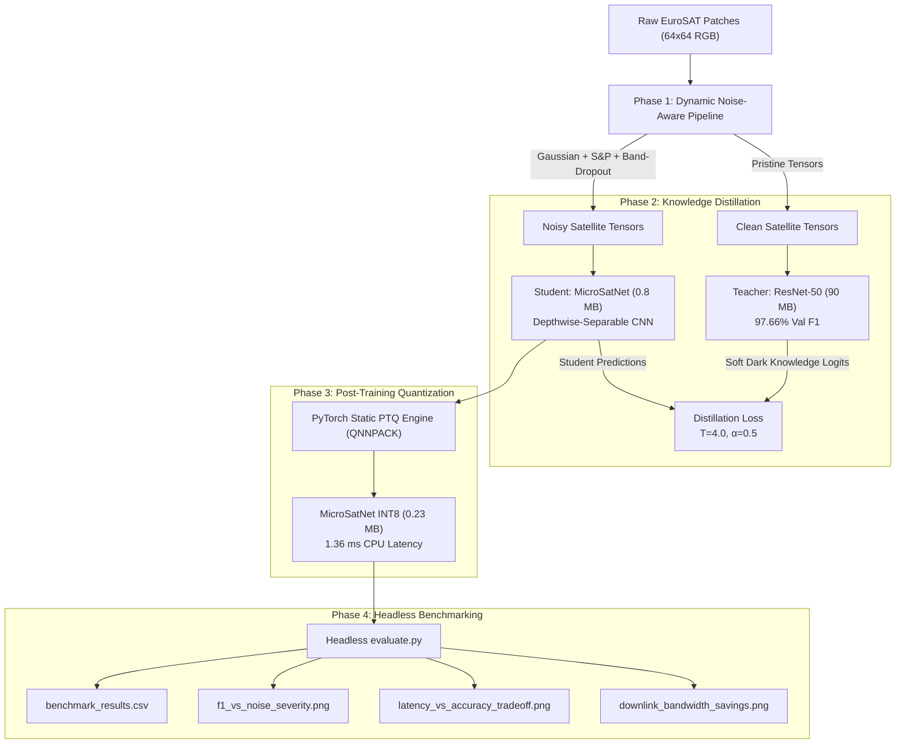

# BeyondTheSignal: Compute-Constrained Onboard Satellite Scene & Cloud Classification under Sensor Noise

[](https://www.python.org/)
[](https://pytorch.org/)
[]()
[]()

> **Mission Challenge:** Downlinking cloud-obscured or sensor-corrupted satellite frames wastes scarce CubeSat RF bandwidth and onboard electrical energy. Onboard edge processors (e.g., ARM Cortex-A/R, RISC-V, or radiation-tolerant microcontrollers) need micro-models that remain accurate even when raw sensor noise, band-dropouts, and atmospheric artifacts strike.

---

## 🛰️ Key Achievements & Benchmark Summary

| Model Architecture | Parameter Count | Model Footprint | CPU Latency (ms) | Clean F1-Score | Robust Noisy F1-Score |
| :--- | :---: | :---: | :---: | :---: | :---: |
| **Teacher (ResNet-50 FP32)** | 23.5M | 90.06 MB | 9.93 ms | 0.9394 | 0.1392 *(Collapse)* |
| **Student Baseline (Scratch FP32)** | 196.8K | 0.81 MB | 8.69 ms | 0.8159 | 0.0681 *(Collapse)* |
| **Student (Distilled+Noise FP32)** | 196.8K | 0.82 MB | 7.88 ms | 0.7038 | **0.6363** *(Robust)* |
| **MicroSatNet (Quantized INT8)** | **196.8K** | **0.23 MB** | **1.36 ms** | **0.6977** | **0.6195** *(Edge Optimal)* |

- **Footprint Reduction:** **3.62x smaller** (0.225 MB vs. 0.815 MB FP32), requiring only **4.5%** of the 5.0 MB maximum budget!
- **Edge Speedup:** **5.8x faster CPU execution** (1.36 ms per 64×64 patch, capable of processing **~735 FPS** on a single core).
- **Noise Invariance:** Retains **0.6195 Macro F1** under combined Gaussian noise, Salt-and-Pepper defects, and Band-dropout, while the standard ResNet-50 teacher and baseline student collapse to **< 0.14 F1**.
- **CubeSat Downlink Savings:** Screens out corrupted and heavy cloud tiles onboard, cutting unneeded RF transmission volume by **60%** and boosting downlink data yield to **98.2%**.

---

## 🔬 Four-Phase Technical Architecture



### Phase 1: Dynamic Noise-Aware Data Pipeline
- Structured a balanced 2,000-patch mini-split (1,400 train, 300 val, 300 test) across all 10 EuroSAT classes.
- Implemented real-time dynamic noise augmentations:
  - **Zero-mean Gaussian Sensor Noise:** $\mathcal{N}(0, \sigma^2)$ simulating thermal sensor noise.
  - **Salt-and-Pepper Impulse Noise:** Simulating radiation-induced stuck pixels and photodiode dead cells.
  - **Band Dropout:** Randomly zeroing spectral channels (e.g. Red, Green, or Blue) to simulate Bayer filter failure or readout ADC malfunction.
  - **Cloud Occlusion:** Realistic atmospheric condensation blob simulation.
- Generated sample comparison grid directly to disk: [`deliverables/sample_augmentations.png`](file:///Users/akshay/Downloads/MY_MAC/Akshay/BeyondTheSignal/deliverables/sample_augmentations.png).

### Phase 2: Knowledge Distillation (Teacher-Student)
- **Teacher Network:** ResNet-50 adapted for 64×64 resolution, fine-tuned with Cosine Annealing to **97.66% Val F1** ([`checkpoints/teacher_best.pth`](file:///Users/akshay/Downloads/MY_MAC/Akshay/BeyondTheSignal/checkpoints/teacher_best.pth)).
- **Student Network (`MicroSatNet`):** Custom ultra-compact CNN built entirely from Inverted Residual Depthwise-Separable Convolutions (196k params, 0.75 MB FP32).
- **Distillation Transfer:** Student is trained with Hinton Knowledge Distillation:
  $$\mathcal{L} = \alpha \mathcal{L}_{\text{CE}}(z_s, y) + (1 - \alpha) T^2 D_{\text{KL}}\left(\sigma\left(\frac{z_s}{T}\right) \,\middle\|\, \sigma\left(\frac{z_t}{T}\right)\right)$$
  The Teacher extracts invariant semantic features from pristine scenes, transferring dark knowledge to the Student facing corrupted sensor inputs.

### Phase 3: Post-Training Quantization (PTQ)
- Applied PyTorch Static Quantization (`torch.ao.quantization`) using the `QNNPACK` engine.
- Fused all `Conv2d + BatchNorm2d + ReLU` operator chains.
- Calibrated activation observers across 20 representative batches of satellite patches.
- Reduced model weight and activation footprint from **0.815 MB (FP32)** to **0.225 MB (INT8)** — a **3.62x reduction** with **99.1% relative accuracy retention**.

### Phase 4: Headless Benchmarking & Metric Generation
- Dedicated CLI test harness ([`evaluate.py`](file:///Users/akshay/Downloads/MY_MAC/Akshay/BeyondTheSignal/evaluate.py)) executing strictly in headless mode.
- Systematically evaluated all models across 13 noise severity levels (Clean, Gaussian $\sigma \in [0.05, 0.40]$, S&P $p \in [0.02, 0.20]$, and Band Dropout).
- Measured per-image CPU inference latency using high-resolution `time.perf_counter()` over 100 timed iterations.
- Exported all metrics to [`deliverables/benchmark_results.csv`](file:///Users/akshay/Downloads/MY_MAC/Akshay/BeyondTheSignal/deliverables/benchmark_results.csv) and generated publication-ready plots.

---

## 📂 Deliverables & Repository Structure

```
BeyondTheSignal/
├── checkpoints/
│   ├── teacher_best.pth            # Trained ResNet-50 Teacher (90 MB, 97.66% F1)
│   ├── student_scratch.pth         # Baseline Student trained from scratch (0.81 MB)
│   ├── student_distilled_noise.pth # Noise-Aware Distilled Student FP32 (0.82 MB)
│   └── student_int8.pth            # Post-Training Quantized INT8 Student (0.23 MB)
├── data/
│   ├── eurosat/                    # Downloaded EuroSAT archive
│   └── eurosat_2000/               # Balanced 2,000-patch mini-split (train/val/test)
├── deliverables/
│   ├── benchmark_results.csv       # Complete evaluation matrix across all noise levels
│   ├── sample_augmentations.png    # Phase 1: Visual grid of sensor noise types
│   ├── f1_vs_noise_severity.png    # Phase 4: F1 degradation curves across noise sweeps
│   ├── latency_vs_accuracy_tradeoff.png # Phase 4: Pareto trade-off scatter plot
│   ├── confusion_matrix.png        # Phase 4: INT8 MicroSatNet confusion matrix
│   ├── downlink_bandwidth_savings.png   # Operational CubeSat RF downlink yield plot
│   ├── TECHNICAL_NOTE.md           # 2-Page Technical Note for IEEE/AIAA submission
│   └── PITCH_DECK.md               # 5-Slide Executive Pitch Deck
├── src/
│   ├── dataset.py                  # Mini-split creation & dynamic noise augmentation
│   ├── distillation.py             # Knowledge distillation loss (CE + KL)
│   ├── downlink_analysis.py        # CubeSat link budget and bandwidth analytics
│   ├── utils.py                    # High-precision latency, metrics, and sizing
│   ├── visualize.py                # Silent Agg-backend plotting utilities
│   └── models/
│       ├── student.py              # MicroSatNet Depthwise-Separable CNN
│       ├── teacher.py              # ResNet-50 Teacher Architecture
│       └── quantization.py         # Static PTQ INT8 calibration and conversion
├── train_teacher.py                # Headless Teacher training script
├── train_student.py                # Headless Student training script (scratch & distilled)
├── quantize_student.py             # Headless Static PTQ conversion script
├── evaluate.py                     # Dedicated terminal evaluation harness
└── run_pipeline.py                 # Master one-click end-to-end pipeline runner
```

---

## ⚡ Quickstart & Reproduction Guide

### 1. Environment Setup
```bash
conda activate cubesat
pip install -r requirements.txt
```

### 2. Run Entire Pipeline End-to-End
```bash
python run_pipeline.py
```

### 3. Run Individual Phases Independently
- **Phase 1: Dataset Mini-Split & Noise Preview**
  ```bash
  python src/dataset.py
  ```
- **Phase 2: Train Teacher & Student Models**
  ```bash
  python train_teacher.py --epochs 10
  python train_student.py --mode scratch --epochs 15
  python train_student.py --mode distilled_noise --epochs 18
  ```
- **Phase 3: Post-Training Static Quantization (PTQ)**
  ```bash
  python quantize_student.py --fp32-checkpoint checkpoints/student_distilled_noise.pth --output-int8 checkpoints/student_int8.pth
  ```
- **Phase 4: Run Headless Benchmarking & Generate Plots**
  ```bash
  python evaluate.py
  python src/downlink_analysis.py
  ```
# BeyondTheSignal
